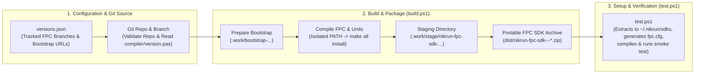

# Nikrun Portable Free Pascal SDKs (`nikrun/sdk`)

[](https://github.com/nikrun/sdk/actions/workflows/build-fpc-sdk.yml)

> **Portable, zero-config, multi-version Free Pascal SDK archives for the [Nikrun](https://github.com/nikrun) ecosystem**

This repository contains the build pipeline, configuration (`versions.json`), and GitHub Actions automation used to compile, package, smoke-test, and publish **self-contained Free Pascal SDK archives** (`nikrun-fpc-sdk-<version>-<commitShortSha>-<cpu>-<os>.zip`).

### Related Nikrun Repositories

- **[`nikrun/cli`](https://github.com/nikrun/cli)** — Standalone `nik` CLI (`nik sdk`, `nik init`, `nik build`, `nik lsp`, `nik.yaml`, and ecosystem design documentation)
- **[`nikrun/vscode`](https://github.com/nikrun/vscode)** — Official `vscode-nikrun` Visual Studio Code extension for Object Pascal / Free Pascal

---

## Overview

Each Nikrun FPC SDK archive bundles everything required to compile and analyze Object Pascal code out-of-the-box:

1. **Branch & Git-URL Driven:** Builds directly from Free Pascal Git branches/refs (or any valid Free Pascal Git repository URL). The exact compiler version is extracted automatically from `compiler/version.pas`, and both the 8-character commit short SHA (in the archive filename/`sdkId`) and full 40-character commit SHA (in `sdk-manifest.json`) are recorded.
2. **Portable Layout:** No hardcoded machine paths in `fpc.cfg`. A clean `fpc.cfg` is generated automatically upon extraction into `~/.nikrun/sdks/<sdkId>`.
3. **Bundled RTL & Packages Sources:** Includes the `.pas`, `.pp`, and `.inc` source files of the Free Pascal Runtime Library (`rtl`) and standard `packages` required by `nik lsp` and IDE language servers for code completion and navigation.
4. **Automated Nightly Updates:** A scheduled GitHub Actions workflow checks all branches configured in [`versions.json`](./versions.json) every night against the commit SHAs published in `index.json` and rebuilds only the branches that received upstream updates.

---

## How Nikrun SDKs Differ from `freepascal.org` Downloads

While `freepascal.org` distributes precompiled release installers (which `build.ps1` uses as clean-room bootstrap seeds where available), those official packages target traditional system-wide installations. Nikrun SDKs are engineered for modern, isolated, multi-version workflows:

| Aspect | Official `freepascal.org` Downloads | Nikrun Portable FPC SDK |
| :--- | :--- | :--- |
| **Installation & Isolation** | OS-specific system installers (`.exe` wizard on Windows, root/admin `.pkg` on macOS, interactive `install.sh` writing `/etc/fpc.cfg` on Linux) that hardcode machine paths globally. | **100% portable user-scope `.zip`** requiring no admin/root privileges. Identical directory layout (`bin/`, `units/`, `source/`, `sdk-manifest.json`) across Windows, Linux, and macOS under `~/.nikrun/sdks/`. |
| **`fpc.cfg` & Modern OS Readiness** | Global configuration; official `3.2.2` installers frequently fail out of the box on modern macOS/Xcode due to missing SDK sysroot (`-XR`) paths or Linux multiarch `crtbegin.o` / `libc` paths. | **Zero-config per-SDK `fpc.cfg`:** `nik` generates an isolated config upon install (dynamically resolving macOS `xcrun` SDK sysroots and Linux library paths) and invokes the compiler with `-n @fpc.cfg`. |
| **Multi-Version & Branch Coverage** | Infrequent static releases (`3.2.2` dates from 2021). Installing multiple versions side by side risks `PATH` and `fpc.cfg` collisions; no prebuilt `main` (`3.3.1`) or `fixes_3_2`. | **Side-by-side versions + nightly builds:** Prebuilt archives for stable (`3.2.2`, `3.2.4`), maintenance (`fixes_3_2` / `3.2.5`), and trunk (`main` / `3.3.1`, including anonymous functions and modern language features). |
| **Native 64-Bit, `aarch64-win64` & Binutils** | No official download for **Windows ARM64 (`aarch64-win64`)**; Windows `3.2.2` defaults to a 32-bit `ppc386` host binary. | Native 64-bit `ppcx64` / `ppca64` compilers everywhere—including **native `aarch64-win64`**—bundled with required Windows binutils (`ld`/`windres` on x64, LLVM `clang`/`llvm-ar` on ARM64). |
| **Bundled RTL & Package Sources** | Binary installers and source archives are often separate downloads or placed in OS-dependent directories. | **IDE & LSP ready:** Every SDK archive includes clean `.pas`, `.pp`, and `.inc` sources under `source/rtl` and `source/packages` for immediate code navigation and `nik lsp` indexing. |
| **CLI, CI/CD & Integrity** | Designed around manual SourceForge downloads and interactive setup wizards. | Machine-readable `sdk-manifest.json` (with exact 40-char `gitCommit` and direct `paths.ppcBinary`) + `index.json` with SHA-256 checksums for unattended `nik sdk install <version>`. |

---

## Architecture & Process Flow



---

## Configured FPC Branches (`versions.json`)

Instead of hardcoding static compiler versions, [`versions.json`](./versions.json) defines the upstream Free Pascal Git branches/tags tracked by the automated build pipeline:

| Branch / Git Ref | Current FPC Version | Windows (`x86_64`) | Windows (`aarch64`) | Linux (`x86_64`) | Linux (`aarch64`) | macOS (`x86_64`) | macOS (`aarch64`) |
| :--- | :---: | :---: | :---: | :---: | :---: | :---: | :---: |
| **`release_3_2_2`** | `3.2.2` | ✅ | *(via `x86_64`)* | ✅ | ✅ | ✅ | ✅ |
| **`release_3_2_4-branch`** | `3.2.4` | ✅ | *(via `x86_64`)* | ✅ | ✅ | ✅ | ✅ |
| **`fixes_3_2`** | `3.2.5` *(moving)* | ✅ | *(via `x86_64`)* | ✅ | ✅ | ✅ | ✅ |
| **`main`** | `3.3.1` *(moving)* | ✅ | ✅ | ✅ | ✅ | ✅ | ✅ |

---

## Scripts Reference

### 1. `build.ps1`
Validates the Git repository and branch/ref, reads the FPC version from `compiler/version.pas`, and builds the portable `.zip` archive and `.sha256` checksum in `dist/`.

```powershell
# Build the default branch from versions.json (release_3_2_4-branch)
.\build.ps1

# Build the Free Pascal development trunk (main)
.\build.ps1 -Branch main

# Build the 3.2 maintenance branch
.\build.ps1 -Branch fixes_3_2

# Build from an explicit Free Pascal Git repository URL and branch
.\build.ps1 -RepoUrl "https://gitlab.com/freepascal.org/fpc/source.git" -Branch main

# Validate repository, fetch source, and inspect extracted version/commit metadata without compiling
.\build.ps1 -Branch main -VerifySourceOnly
```

**Parameters:**
- `-Branch` *(Aliases: `-GitRef`, `-Ref`)*: Git branch, tag, or ref to build (defaults to `defaultBranch` in `versions.json`)
- `-RepoUrl` *(Aliases: `-GitRepo`, `-Url`)*: Free Pascal Git repository URL (defaults to `https://gitlab.com/freepascal.org/fpc/source.git`)
- `-Commit`: Optional exact Git commit SHA override while keeping `-Branch` as the recorded `gitRef`
- `-TargetOs`: `auto` (default), `win64`, `linux`, `darwin`
- `-TargetCpu`: `auto` (default), `x86_64`, `aarch64`
- `-SkipZip`: Populates `.work/stage/<sdkId>` without compressing to `.zip`
- `-VerifySourceOnly`: Validates the Git repository, checks Free Pascal source layout, and outputs extracted version & commit metadata without running `make`

---

### 2. `test.ps1`
Extracts a built FPC SDK `.zip` archive into `~/.nikrun/sdks/<sdkId>`, verifies `sdk-manifest.json` (including `gitCommit`), generates `fpc.cfg`, and compiles + runs an isolated smoke-test program (`smoketest.pas`).

```powershell
# Extract the most recently built archive from ./dist, configure fpc.cfg, and run smoke test
.\test.ps1

# Test a specific archive into a custom directory
.\test.ps1 -ZipPath .\dist\nikrun-fpc-sdk-3.2.4-66940ee6-x86_64-win64.zip -InstallRoot "C:\Tools\nikrun-sdks"

# Test an already extracted FPC SDK directory directly
.\test.ps1 -SdkPath "$env:USERPROFILE\.nikrun\sdks\nikrun-fpc-sdk-3.2.4-66940ee6-x86_64-win64"
```

---

### 3. `resolve-matrix.ps1`, `publish-release.ps1` & `format-release-notes.ps1`
CI/release automation scripts invoked by [`.github/workflows/build-fpc-sdk.yml`](./.github/workflows/build-fpc-sdk.yml) (and directly runnable locally for dry-run testing):

```powershell
# Check upstream Git commits against versions.json and preview the filtered build matrix
.\resolve-matrix.ps1 -Branch main,fixes_3_2 -TargetFilter x86_64-win64 -ForceRebuild

# Dry-run index.json & release-notes.md generation locally from ./dist archives
.\publish-release.ps1 -InputDir .\dist -Repository nikrun/sdk -DryRun

# Render the Markdown version-by-target release notes table from an existing index.json
.\format-release-notes.ps1 -IndexPath .\index.json -OutputPath .\release-notes.md
```

---

## FPC SDK Archive Structure

Every `nikrun-fpc-sdk-<version>-<commitShortSha>-<cpu>-<os>.zip` archive follows an identical layout across all operating systems:

```text
nikrun-fpc-sdk-<version>-<commitShortSha>-<cpu>-<os>.zip
├── sdk-manifest.json          # Version, gitRepo, gitRef, full gitCommit SHA, target triplet & paths
├── bin/
│   └── <cpu>-<os>/            # fpc, ppcx64/ppca64, fpcmkcfg, make, ld, as, ar, windres...
│                              # (fpc.cfg is generated here upon installation)
├── units/
│   └── <cpu>-<os>/            # Precompiled .ppu units (rtl, fcl-*, rtl-generics, etc.)
└── source/
    ├── rtl/                   # Clean RTL source files (.pas, .pp, .inc) for IDE IntelliSense
    └── packages/              # Clean standard package source files for IDE IntelliSense
```

> **Note on `ppc*` vs. `fpc`:** In Free Pascal, `ppcx64` / `ppca64` (*Portable Pascal Compiler*) is the actual CPU-specific compiler backend, whereas `fpc` (`compiler/utils/fpc.pp`) is only a thin upstream CLI dispatcher that selects a `ppc*` binary and forwards flags. Both paths are recorded in `sdk-manifest.json` (`paths.ppcBinary` and `paths.fpcBinary`): `nik` targets `ppc*` directly to avoid an extra wrapper hop and global `PATH` side effects, while `fpc` remains included for compatibility with external scripts and Makefiles.

---

## License

Pipeline scripts and configuration in this repository are licensed under the [MIT License](./LICENSE). Built Free Pascal compiler binaries, runtime libraries, and bundled source files inside generated SDK archives remain under their respective upstream [Free Pascal licenses](https://www.freepascal.org/faq.html#general-license) (GPLv2+ for the compiler; modified LGPL with static linking exception for the RTL and packages).
