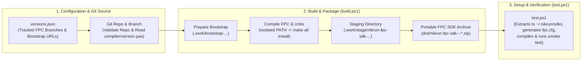

<p align="left">
  <picture>
    <source media="(prefers-color-scheme: dark)" srcset="https://nikrun.dev/brand/nikrun-lockup-dark-mono.svg">
    
  </picture>
</p>

# Nikrun SDKs

[](https://github.com/nikrun/sdk/actions/workflows/build-fpc-sdk.yml)
[](./LICENSE)
[](https://nikrun.dev)

> **Portable, prebuilt multi-version & multi-arch Free Pascal toolchains for Windows, Linux, and macOS.**

[nikrun.dev](https://nikrun.dev) · [`nik` CLI](https://github.com/nikrun/cli) · **[Free Pascal SDKs](https://github.com/nikrun/sdk)** · [VS Code Extension](https://github.com/nikrun/vscode) · [Website & Docs](https://github.com/nikrun/web) · [Brand Assets](https://github.com/nikrun/brand) · [Build Library](https://github.com/nikrun/build-lib)

---

**Nikrun SDKs** provide clean-room, SHA-256-verified **Free Pascal** compiler toolchains designed to install side by side strictly in user scope (`~/.nikrun/sdks/`) via `nik sdk install`.

This repository contains the build pipeline, branch configuration ([`versions.json`](./versions.json)), and scheduled GitHub Actions automation used to compile, package, smoke-test, and publish self-contained SDK archives (`nikrun-fpc-sdk-<version>-<commitShortSha>-<cpu>-<os>.zip`).

---

## Overview

Each portable Free Pascal SDK archive bundles everything required to compile and analyze Object Pascal code out of the box:

- **Branch & Git-URL Driven:** Builds directly from upstream Free Pascal Git branches/refs. The exact compiler version is extracted automatically from `compiler/version.pas`, recording both the 8-character commit short SHA (in the archive filename/`sdkId`) and the full 40-character commit SHA (in `sdk-manifest.json`).
- **100% Portable User-Scope Layout:** No hardcoded machine paths. An isolated per-SDK `fpc.cfg` is generated automatically upon extraction into `~/.nikrun/sdks/<sdkId>`.
- **Bundled RTL & Packages Sources:** Includes clean `.pas`, `.pp`, and `.inc` source files of the Free Pascal Runtime Library (`source/rtl`) and standard `source/packages` required by the built-in Language Server (`nik lsp`) for instant navigation and code intelligence.
- **Automated Nightly Updates:** A scheduled GitHub Actions workflow checks all branches configured in [`versions.json`](./versions.json) nightly against the commit SHAs published in `index.json` and rebuilds only the branches that received upstream commits.

### How Nikrun SDKs Compare

| Aspect | Official `freepascal.org` Installers | **Nikrun SDKs** |
| :--- | :--- | :--- |
| **Installation & Isolation** | OS-specific system installers (`.exe` wizard, root `.pkg`, interactive `install.sh` writing `/etc/fpc.cfg`) that hardcode machine paths globally. | **100% portable user-scope `.zip`** requiring no admin/root privileges, with an identical layout across Windows, Linux, and macOS under `~/.nikrun/sdks/`. |
| **`fpc.cfg` & Modern OS Support** | Global configuration; official `3.2.2` installers frequently hit missing Xcode sysroot (`-XR`) or Linux multiarch `crtbegin.o` / `libc` path snags. | **Zero-config per-SDK `fpc.cfg`:** `nik` resolves macOS `xcrun` SDK sysroots and Linux library paths automatically and invokes `ppc*` with `-n @fpc.cfg`. |
| **Multi-Version & Nightly Trunk** | Infrequent static releases (`3.2.2` is from 2021); parallel installs collide in `PATH` and `fpc.cfg`; no prebuilt `main` (`3.3.1`) or `fixes_3_2`. | **Side-by-side versions + nightly builds:** Prebuilt archives for stable (`3.2.2`, `3.2.4`), maintenance (`fixes_3_2` / `3.2.5`), and trunk (`main` / `3.3.1`). |
| **Native 64-Bit & `aarch64-win64`** | No official download for **Windows ARM64 (`aarch64-win64`)**; Windows `3.2.2` defaults to a 32-bit `ppc386` host binary. | Native 64-bit `ppcx64` / `ppca64` compilers everywhere — including **native `aarch64-win64`** — bundled with platform binutils (`ld`/`windres` or LLVM `clang`/`llvm-ar`). |
| **Bundled RTL & Package Sources** | Binary installers and source archives are often separate downloads or placed in OS-dependent directories. | **IDE & LSP ready:** Every archive includes clean `.pas`, `.pp`, and `.inc` sources under `source/rtl` and `source/packages`. |
| **CLI, CI/CD & Integrity** | Designed around manual downloads and interactive setup wizards. | Machine-readable `sdk-manifest.json` + `index.json` with SHA-256 checksums for unattended `nik sdk install <version>`. |

---

## Architecture



### Supported Free Pascal Branches (`versions.json`)

| Branch / Git Ref | Current FPC Version | Windows (`x86_64`) | Windows (`aarch64`) | Linux (`x86_64`) | Linux (`aarch64`) | macOS (`x86_64`) | macOS (`aarch64`) |
| :--- | :---: | :---: | :---: | :---: | :---: | :---: | :---: |
| **`release_3_2_2`** | `3.2.2` | ✅ | *(via `x86_64`)* | ✅ | ✅ | ✅ | ✅ |
| **`release_3_2_4-branch`** | `3.2.4` | ✅ | *(via `x86_64`)* | ✅ | ✅ | ✅ | ✅ |
| **`fixes_3_2`** | `3.2.5` *(moving)* | ✅ | *(via `x86_64`)* | ✅ | ✅ | ✅ | ✅ |
| **`main`** | `3.3.1` *(moving)* | ✅ | ✅ | ✅ | ✅ | ✅ | ✅ |

---

## Quick Start

To install prebuilt SDKs as a developer, use the **`nik` CLI** ([`nikrun/cli`](https://github.com/nikrun/cli)):

```bash
nik sdk list --remote            # Browse available prebuilt SDKs across versions & architectures
nik sdk install 3.2.4            # Download, SHA-256 verify, and configure Free Pascal 3.2.4
nik sdk install 3.3.1            # Install nightly Free Pascal 3.3.1 side by side
nik sdk update                   # Update installed SDKs to the newest prebuilt commits
```

---

## Repository Structure & SDK Layout

```text
nikrun-fpc-sdk-<version>-<commitShortSha>-<cpu>-<os>.zip
├── sdk-manifest.json          # Version, gitRepo, gitRef, full gitCommit SHA, target triplet & paths
├── bin/
│   └── <cpu>-<os>/            # fpc, ppcx64/ppca64, fpcmkcfg, make, ld, as, ar, windres...
│                              # (fpc.cfg is generated here upon installation)
├── units/
│   └── <cpu>-<os>/            # Precompiled .ppu units (rtl, fcl-*, rtl-generics, etc.)
├── source/
│   ├── rtl/                   # Clean RTL source files (.pas, .pp, .inc) for nik lsp
│   └── packages/              # Clean standard package source files for nik lsp
└── licenses/                  # Upstream FPC (GPLv2+, COPYING.FPC), binutils (GPLv3) & notice files
```

> **Note on `ppc*` vs. `fpc`:** In Free Pascal, `ppcx64` / `ppca64` (*Portable Pascal Compiler*) is the actual CPU-specific compiler backend, whereas `fpc` (`compiler/utils/fpc.pp`) is a thin upstream CLI wrapper that selects a `ppc*` binary and forwards flags. Both paths are recorded in `sdk-manifest.json` (`paths.ppcBinary` and `paths.fpcBinary`): `nik` invokes `ppc*` directly to avoid an extra wrapper hop and global `PATH` side effects, while `fpc` remains included for compatibility with external scripts and Makefiles.

---

## Development & Testing

### 1. Build an SDK Archive (`build.ps1`)

```powershell
# Build the default branch from versions.json (release_3_2_4-branch)
.\build.ps1

# Build the Free Pascal development trunk (main) or 3.2 maintenance branch
.\build.ps1 -Branch main
.\build.ps1 -Branch fixes_3_2

# Validate repository, fetch source, and inspect extracted version/commit metadata without compiling
.\build.ps1 -Branch main -VerifySourceOnly
```

**Key Parameters:** `-Branch` (`-GitRef`), `-RepoUrl` (`-GitRepo`), `-Commit`, `-TargetOs` (`auto`, `win64`, `linux`, `darwin`), `-TargetCpu` (`auto`, `x86_64`, `aarch64`), `-SkipZip`, `-VerifySourceOnly`.

### 2. Smoke-Test an SDK Archive (`test.ps1`)

```powershell
# Extract the most recently built archive from ./dist, configure fpc.cfg, and run smoke test
.\test.ps1

# Test a specific archive or an already extracted SDK directory
.\test.ps1 -ZipPath .\dist\nikrun-fpc-sdk-3.2.4-66940ee6-x86_64-win64.zip -InstallRoot "C:\Tools\nikrun-sdks"
.\test.ps1 -SdkPath "$env:USERPROFILE\.nikrun\sdks\nikrun-fpc-sdk-3.2.4-66940ee6-x86_64-win64"
```

### 3. Matrix & Release Automation Scripts

```powershell
# Check upstream Git commits against versions.json and preview the filtered build matrix
.\resolve-matrix.ps1 -Branch main,fixes_3_2 -TargetFilter x86_64-win64 -ForceRebuild

# Dry-run index.json & release-notes.md generation locally from ./dist archives
.\publish-release.ps1 -InputDir .\dist -Repository nikrun/sdk -DryRun

# Render the Markdown version-by-target release notes table from an existing index.json
.\format-release-notes.ps1 -IndexPath .\index.json -OutputPath .\release-notes.md
```

---

## License

Copyright (c) 2026 The Nikrun Contributors.

Pipeline scripts and configuration in this repository are licensed under the **GNU General Public License v3.0 or later** (`GPL-3.0-or-later`) — see [LICENSE](./LICENSE).

> **Note on Bundled Upstream Toolchains:** Built Free Pascal compiler binaries, runtime libraries, binutils, and bundled source files inside generated SDK archives remain under their respective upstream [Free Pascal licenses](https://www.freepascal.org/faq.html#general-license) (GPLv2+ for the compiler; modified LGPL with static linking exception for the RTL and packages; GPLv3 / Apache-2.0 with LLVM Exception for bundled platform binutils). Compiling your own applications with these SDKs imposes no licensing restrictions on your code.
